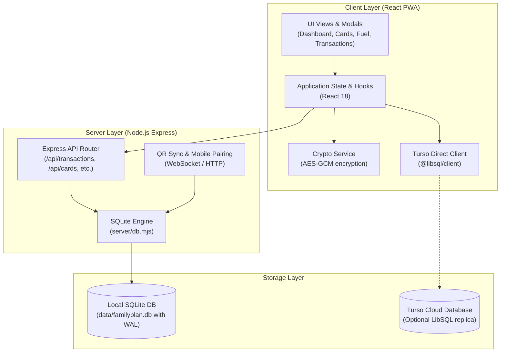

# Code and Architecture

## Actual stack

- **Frontend Application:** React 18.3.1, TypeScript 5.7.2, Vite 6.0.5, Tailwind CSS 3.4.17, `vite-plugin-pwa` 2.0.0.
- **UI Components & Charts:** Lucide React 0.468.0, Recharts 2.15.0.
- **Backend Server:** Node.js Express 4.21.2.
- **Persistence & Driver:** Native Node.js SQLite (`node:sqlite`) in WAL mode, paired with `@libsql/client` 0.18.0 for Turso cloud database synchronization.
- **Runtime & Tooling:** Node.js v26.11.1 (compatible with v22+), npm 11.20.0, ESLint 9 (flat config).

*Stack Decision:* We strictly preserve the native `node:sqlite` and Turso client architecture. We do not migrate to PostgreSQL or Drizzle ORM because Prumo is designed specifically as a zero-dependency, local-first offline desktop and mobile tool.

## Code map

```text
Prumo/
├── data/                    # Local SQLite databases (gitignored: *.db, *.db-wal)
├── docs/                    # Canonical architecture, design, quality, and onboarding docs
│   ├── architecture.md      # This file: system architecture, stack, and data flow
│   ├── design.md            # Prumo Design System, color tokens, and PWA standards
│   ├── onboarding.md        # Local development setup and running instructions
│   ├── quality.md           # Quality gates, verify scripts, and security review prompt
│   ├── setup.md             # Vibe coding toolkit adoption audit and matrix
│   └── task-handoff.md      # Multi-session task handoff template
├── public/                  # Static web assets, PWA icons, manifest
├── scripts/                 # Utility scripts (icon generation, DB inspection/migration)
│   ├── generate-png-icons.mjs
│   ├── inspect-turso.mjs
│   ├── migrate-backup-to-turso.mjs
│   ├── reset-turso-production.mjs
│   └── verify.mjs           # Quality gate verification runner
├── server/                  # Backend Express and SQLite persistence engine
│   ├── db.mjs               # Database schema initialization, migrations, and queries
│   └── index.mjs            # Express server entry point, API routes, QR code server
├── src/                     # Frontend React + TypeScript application
│   ├── components/          # UI views, modals, and charts
│   │   ├── icons/           # Custom SVG icon components
│   │   ├── BalanceModal.tsx
│   │   ├── CreditCardExpenseModal.tsx
│   │   ├── CreditCardModal.tsx
│   │   ├── CreditCardsView.tsx
│   │   ├── DashboardView.tsx
│   │   ├── FuelLogModal.tsx
│   │   ├── FuelView.tsx
│   │   ├── MobileSyncModal.tsx
│   │   ├── RecurringView.tsx
│   │   ├── ReportsView.tsx
│   │   ├── SeriesConfirmModal.tsx
│   │   ├── TransactionModal.tsx
│   │   └── TransactionsView.tsx
│   ├── services/            # Client-side data, encryption, and sync services
│   │   ├── cryptoService.ts # Local AES-GCM encryption for multi-device sync
│   │   ├── tursoDirectClient.ts # Direct client queries to Turso DB
│   │   └── tursoService.ts  # Higher-level sync routines
│   ├── types/               # Domain TypeScript interfaces and types
│   ├── utils/               # Formatting, currency, date, and math utilities
│   ├── App.tsx              # Main application container, router, and view switcher
│   ├── main.tsx             # React DOM entry point
│   └── index.css            # Tailwind directives and CSS theme variables
├── .env                     # Local environment variables (Turso URL and tokens)
├── AGENTS.md                # AI agent canonical instructions and working agreements
├── CLAUDE.md                # Multi-client bridge importing AGENTS.md
├── GEMINI.md                # Workspace-specific design and preview rules
├── PRODUCT.md               # Core product definition and MVP requirements
└── package.json             # NPM package manifest
```

## Boundaries and data flow



1. **Client Layer:** React PWA with standard mobile-first containment. User actions mutate state through custom hooks and services.
2. **Local Server Layer:** Express API handles CRUD operations for transactions, categories, credit cards, fuel logs, and balance records.
3. **Synchronization:** Scannable QR Code allows mobile devices on the same Wi-Fi network to securely authenticate and synchronize data directly with the local server.
4. **Cloud Mirroring:** Optional end-to-end synchronization via Turso Direct Client allows multi-device access outside local Wi-Fi without third-party exposure.

## Data and persistence

- **Local SQLite Engine:** Uses Node.js native `node:sqlite` with Write-Ahead Logging (`WAL`) enabled for fast concurrent read/write transactions.
- **Schema Management:** `server/db.mjs` executes automatic schema migration on startup, creating tables for:
  - `transactions`
  - `categories`
  - `credit_cards`
  - `credit_card_invoices`
  - `credit_card_expenses`
  - `fuel_logs`
  - `balance_history`
- **Transactions:** High-volume operations (e.g., invoice payments, series cancellations) use atomic SQLite transactions.

## Decisions

- **Decision 1: Native SQLite over Drizzle/Postgres.**
  - *Reason:* Prumo is a personal desktop/laptop app that must run offline without setting up Docker or external databases.
- **Decision 2: Strict 2-Theme System (OLED & Claro).**
  - *Reason:* Maximizes battery efficiency on mobile OLED displays while providing a crisp daylight option. Legacy dark themes are deprecated.
- **Decision 3: Mobile-First Max-Width Containment.**
  - *Reason:* By restricting desktop layouts to `max-w-lg mx-auto`, the UX remains identical across all devices and prevents oversized cards on wide screens.

## Maintenance

Update this architecture document whenever new service layers, database tables, or sync boundaries are introduced.
